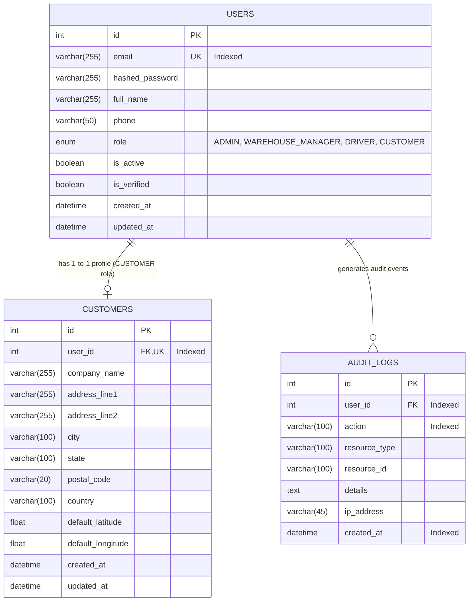

# Database Design & Entity Relationship Specification

---

## 1. Overview & Strategy
The database for the Intelligent Logistics & Delivery Optimization Platform (ILDO) is deployed on **MySQL 8.0 / 26.7** under the dedicated schema `ildo_db` with `utf8mb4_unicode_ci` collation.

### Core Principles
1. **Normalization:** Structured to 3NF, eliminating data duplication while preserving query efficiency.
2. **Referential Integrity:** Foreign keys use explicit cascade and nullification policies (`ON DELETE CASCADE`, `ON DELETE SET NULL`).
3. **Optimized Indexing:** Strategic B-tree indexes placed on lookup keys (emails, role, foreign keys, status fields, and audit timestamps).
4. **Evolutive Schema Migrations:** All schema changes are tracked and executed via Alembic migrations without table resets.

---

## 2. Entity Relationship Diagram (Auth & Identity Scope)

---

## 3. Detailed Data Dictionary

### Table: `users`
| Column | Type | Nullable | Key / Constraints | Description |
|---|---|---|---|---|
| `id` | `INT` | No | PK, Auto Increment | Unique system user ID |
| `email` | `VARCHAR(255)` | No | UNIQUE, INDEX | User login and contact email |
| `hashed_password` | `VARCHAR(255)` | No | | Cryptographic bcrypt password hash (salt rounds = 12) |
| `full_name` | `VARCHAR(255)` | No | | User display name |
| `phone` | `VARCHAR(50)` | Yes | | Contact mobile number |
| `role` | `ENUM` | No | INDEX | `ADMIN`, `WAREHOUSE_MANAGER`, `DRIVER`, `CUSTOMER` |
| `is_active` | `BOOLEAN` | No | Default `TRUE` | Account lock/active flag |
| `is_verified` | `BOOLEAN` | No | Default `FALSE` | Email / identity verification flag |
| `created_at` | `DATETIME` | No | Default `CURRENT_TIMESTAMP` | Creation timestamp |
| `updated_at` | `DATETIME` | No | Default `CURRENT_TIMESTAMP` | Last modified timestamp |

### Table: `customers`
| Column | Type | Nullable | Key / Constraints | Description |
|---|---|---|---|---|
| `id` | `INT` | No | PK, Auto Increment | Unique customer profile ID |
| `user_id` | `INT` | No | FK(`users.id` ON DELETE CASCADE), UNIQUE | Associated user ID |
| `company_name` | `VARCHAR(255)` | Yes | | Business / entity name |
| `address_line1` | `VARCHAR(255)` | Yes | | Street address line 1 |
| `address_line2` | `VARCHAR(255)` | Yes | | Apartment / suite / unit |
| `city` | `VARCHAR(100)` | Yes | | Delivery city |
| `state` | `VARCHAR(100)` | Yes | | Province / State |
| `postal_code` | `VARCHAR(20)` | Yes | | ZIP / Postal code |
| `country` | `VARCHAR(100)` | No | Default `'India'` | Country of delivery |
| `default_latitude` | `FLOAT` | Yes | | Geocoded latitude for distance computation |
| `default_longitude` | `FLOAT` | Yes | | Geocoded longitude for distance computation |
| `created_at` | `DATETIME` | No | Default `CURRENT_TIMESTAMP` | Record creation timestamp |
| `updated_at` | `DATETIME` | No | Default `CURRENT_TIMESTAMP` | Last modified timestamp |

### Table: `audit_logs`
| Column | Type | Nullable | Key / Constraints | Description |
|---|---|---|---|---|
| `id` | `INT` | No | PK, Auto Increment | Audit log identifier |
| `user_id` | `INT` | Yes | FK(`users.id` ON DELETE SET NULL), INDEX | Responsible user |
| `action` | `VARCHAR(100)` | No | INDEX | Action code (`USER_REGISTER`, `USER_LOGIN`, etc.) |
| `resource_type` | `VARCHAR(100)` | Yes | | Target entity type |
| `resource_id` | `VARCHAR(100)` | Yes | | Target entity ID |
| `details` | `TEXT` | Yes | | Contextual event metadata |
| `ip_address` | `VARCHAR(45)` | Yes | | Client IPv4 or IPv6 address |
| `created_at` | `DATETIME` | No | Default `CURRENT_TIMESTAMP`, INDEX | Timestamp of event |
