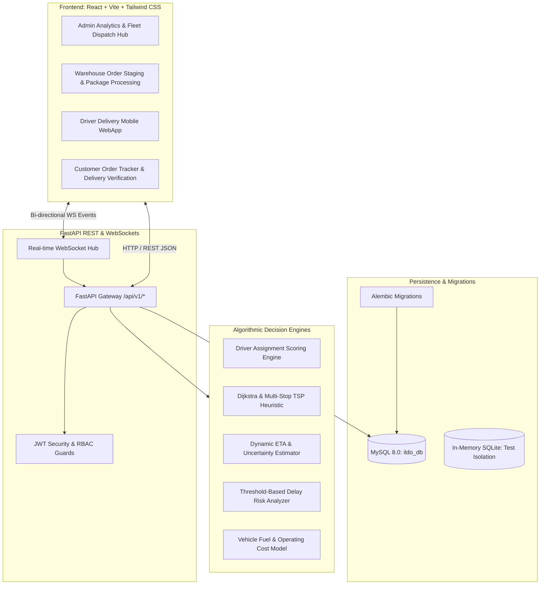

# Intelligent Logistics & Delivery Optimization Platform (ILDO)
## System Architecture Specification

---

### 1. Architectural Philosophy
ILDO is built as a modular, decoupled full-stack logistics management platform. The architecture separates presentation, API gateway & real-time communication, business domain services, pure algorithmic decision-making, and persistence.

No fake functionality is permitted:
- Geolocation tracking uses actual W3C Browser Geolocation updates streamed via authenticated WebSockets.
- Route planning uses real Dijkstra shortest-path calculations and Nearest-Neighbor heuristics over calibrated distance metrics.
- ETA predictions transparently factor remaining distance, calibrated vehicle speeds, stop-service duration, and uncertainty buffers.
- Driver assignment scores are computed using normalized multi-factor linear equations with strict hard constraint rejection filters.

---

### 2. High-Level Architecture Diagram

---

### 3. Module Responsibilities

| Module | Location | Primary Responsibility |
|---|---|---|
| **Core Config** | `backend/app/core/config.py` | Environment variable validation, database URI construction, algorithm hyperparameters. |
| **Database Pool** | `backend/app/core/database.py` | SQLAlchemy 2.0 engine, connection pooling (`pool_pre_ping=True`, `pool_recycle=3600`), transaction session management (`get_db`). |
| **Security & RBAC** | `backend/app/core/security.py` | Native bcrypt salt/hash generation, JWT HS256 token encoding/decoding, role permission verification. |
| **Structured Logger** | `backend/app/core/logger.py` | Centralized application logging with context, log level filtering, and sensitive credential masking. |
| **API Endpoints** | `backend/app/api/v1/` | REST controllers managing request validation, service orchestration, and response schemas. |
| **Intelligence Services** | `backend/app/intelligence/` | Pure algorithmic implementations decoupled from database models. |
| **WebSocket Hub** | `backend/app/websockets/` | Channel-based real-time event broadcasting (`admin`, `driver_{id}`, `customer_{id}`). |
| **Frontend Client** | `frontend/src/api/` | Axios instance with JWT interceptor, token refresh, and standardized error extraction. |

---

### 4. Security Boundaries & Access Control

1. **Role-Based Access Control (RBAC):**
   - `ADMIN`: Full administrative control over users, fleet, warehouses, orders, algorithms, and audit records.
   - `WAREHOUSE_MANAGER`: Scoped to assigned warehouse order processing and packaging readiness.
   - `DRIVER`: Scoped strictly to assigned active deliveries, route visualization, and proof-of-delivery submission.
   - `CUSTOMER`: Strict resource ownership. A customer cannot view or modify any delivery or order not belonging to their user account.
2. **Credential Safety:**
   - Passwords hashed using bcrypt with salt rounds = 12.
   - Secrets read exclusively from environment variables.
   - `.env` files strictly excluded from Git tracking via `.gitignore`.
