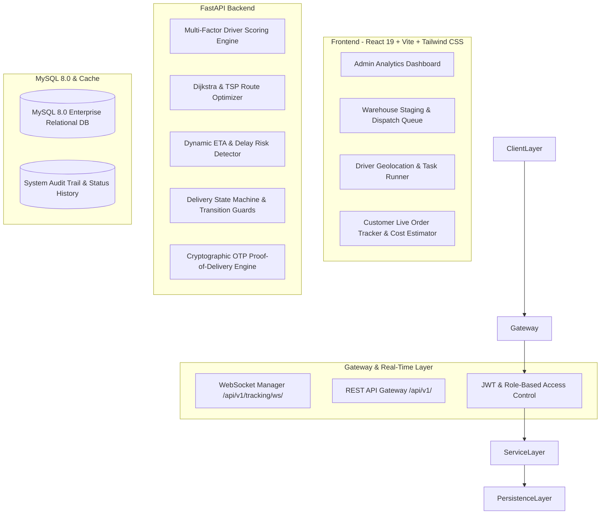
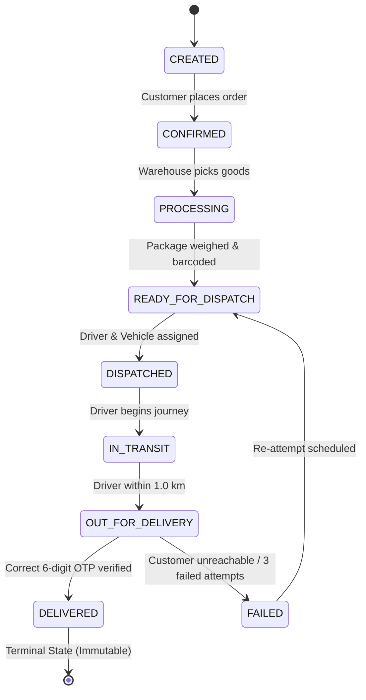

# Intelligent Logistics & Delivery Optimization Platform (ILDO)
## Comprehensive Academic Viva Defense & Presentation Guide

---

## 1. Executive Summary & Problem Formulation

### 1.1 The Industry Problem
Modern supply-chain logistics and last-mile delivery face critical operational bottlenecks:
- **Suboptimal Driver Allocation**: Manual or purely geographic assignment ignores vehicle payload limits, real-time driver workload, and historical reliability, leading to fleet overload and delayed dispatches.
- **Static vs. Dynamic ETA Disconnect**: Traditional platforms compute static routing distances that fail to account for live driver speed variations, traffic congestion, and loading/unloading overhead.
- **Lack of Delivery Integrity**: Reliance on physical signatures or unverified phone confirmations leads to delivery fraud, missed drops, and dispute costs.
- **Siloed Operational Visibility**: Warehouse dispatchers, fleet drivers, system administrators, and customers lack a synchronized, real-time single source of truth.

### 1.2 The ILDO Solution
**ILDO** is an enterprise-grade full-stack logistics platform combining:
1. **Multi-Factor Weighted Driver Scoring**: Autonomous driver ranking incorporating distance, workload, performance rating, order priority, and hard payload constraints.
2. **Graph-Theoretic Route Optimization**: Dijkstra's shortest path algorithm combined with a Nearest-Neighbor Traveling Salesperson Problem (TSP) heuristic for multi-stop dispatches.
3. **Real-Time Geolocation & Dynamic ETA Engine**: Browser Geolocation API streaming over authenticated WebSockets, computing dynamic ETAs with traffic penalty factors and predictive delay risk detection.
4. **Verifiable Proof of Delivery (PoD)**: Time-limited cryptographic One-Time Password (OTP) verification with brute-force attempt lockout and structured delivery failure logging.
5. **Role-Based Enterprise Dashboards**: Dedicated UI experiences for **Admins**, **Warehouse Managers**, **Drivers**, and **Customers**.

---

## 2. System Architecture & High-Level Flow

### 2.1 Multi-Tier Architecture Diagram

---

## 3. Core Algorithms Explained Mathematically

### 3.1 Multi-Factor Driver Assignment Engine
When an order in status `READY_FOR_DISPATCH` requires driver assignment, candidates are first filtered by **hard constraints**:
1. Driver status must be `AVAILABLE`.
2. Assigned vehicle must be `AVAILABLE` or `IN_SERVICE` (never `MAINTENANCE` or `UNAVAILABLE`).
3. Assigned vehicle payload capacity:
   $$\text{Vehicle.max\_weight\_capacity\_kg} \ge \text{Package.weight\_kg}$$
4. Driver active concurrent orders must not exceed the maximum threshold:
   $$\text{active\_deliveries\_count} < \text{MAX\_CONCURRENT\_ORDERS} = 3$$

For all qualifying candidates, an aggregate fitness score $S \in [0, 100]$ is computed:

$$S = w_1 \cdot S_{\text{dist}} + w_2 \cdot S_{\text{workload}} + w_3 \cdot S_{\text{rating}} + w_4 \cdot S_{\text{priority}}$$

Where:
- **Weights**: $w_1 = 0.40$, $w_2 = 0.25$, $w_3 = 0.20$, $w_4 = 0.15$ ($\sum w_i = 1.0$)
- **Distance Score** $S_{\text{dist}}$:
  $$S_{\text{dist}} = \max\left(0, 100 - \frac{\text{Distance}(\text{Driver}, \text{Warehouse})}{\text{MAX\_RADIUS\_KM}} \times 100\right)$$
- **Workload Score** $S_{\text{workload}}$:
  $$S_{\text{workload}} = \left(1 - \frac{\text{active\_deliveries}}{3}\right) \times 100$$
- **Rating Score** $S_{\text{rating}}$:
  $$S_{\text{rating}} = \frac{\text{Driver.rating}}{5.0} \times 100$$
- **Priority Urgency Multiplier** $S_{\text{priority}}$:
  $$\text{LOW}: 25,\quad \text{MEDIUM}: 50,\quad \text{HIGH}: 75,\quad \text{URGENT}: 100$$

The candidate with $\max(S)$ is assigned.

---

### 3.2 Great-Circle Distance (Haversine Formula)
To compute precise surface distances between arbitrary coordinates $(\phi_1, \lambda_1)$ and $(\phi_2, \lambda_2)$ without external billable API dependencies:

$$a = \sin^2\left(\frac{\Delta \phi}{2}\right) + \cos(\phi_1)\cos(\phi_2)\sin^2\left(\frac{\Delta \lambda}{2}\right)$$
$$c = 2 \cdot \text{atan2}\left(\sqrt{a}, \sqrt{1 - a}\right)$$
$$d = R \cdot c \quad (R = 6371.0\text{ km})$$

---

### 3.3 Graph-Theoretic Routing & TSP Sequencing
1. **Dijkstra's Shortest Path Algorithm**:
   - Represents delivery network intersections as vertices $V$ and road segments as weighted directed edges $E$.
   - Edge weights represent effective travel cost: $w(u, v) = \text{distance} \times \text{traffic\_factor}$.
   - Priority queue (min-heap) yields the optimal path in $O((|E| + |V|)\log |V|)$ time.
2. **Nearest-Neighbor Traveling Salesperson Problem (TSP) Heuristic**:
   - For multi-stop dispatches, orders $p_1, p_2, \dots, p_n$ are sequenced starting from warehouse origin $W_0$.
   - Iteratively selects the unvisited node nearest to current position:
     $$p^* = \arg\min_{p_i \in \text{Unvisited}} d(current, p_i)$$
   - Operates in $O(n^2)$ time with a $2$-approximation factor, optimal for real-time mobile scheduling.

---

### 3.4 Dynamic ETA & Delay Risk Detection
Standard navigation calculates $\text{ETA} = \frac{\text{Distance}}{\text{Speed}}$. ILDO enhances this with dynamic real-world parameters:

$$\text{ETA}_{\text{minutes}} = \left(\frac{\text{Remaining Distance (km)}}{\text{Effective Speed (km/h)}} \times 60 \times T_f\right) + S_{\text{time}} + B_{\text{buffer}}$$

Where:
- $T_f$: Traffic Congestion Factor ($1.0$ for free-flow, $1.35$ for peak hours).
- $S_{\text{time}}$: Service Time constant ($5$ to $10$ minutes per stop for parking and handover).
- $B_{\text{buffer}}$: Priority buffer based on order criticality.

**Delay Risk Classification Engine**:
$$\Delta T = \text{Predicted Arrival Time} - \text{Promised SLA Deadline}$$

$$\text{Risk Category} = \begin{cases}
\text{NONE} & \text{if } \Delta T \le 0 \\
\text{LOW} & \text{if } 0 < \Delta T \le 15\text{ min} \\
\text{MEDIUM} & \text{if } 15 < \Delta T \le 30\text{ min} \\
\text{HIGH} & \text{if } \Delta T > 30\text{ min}
\end{cases}$$

When `HIGH` risk is detected, the system triggers real-time alerts to the warehouse manager and customer.

---

### 3.5 Cryptographic Proof-of-Delivery (PoD) State Machine

**Security Invariants Enforced**:
- OTP is a cryptographically generated 6-digit code with a 2-hour sliding window.
- Max 3 verification attempts before temporary lockout.
- State transitions are strictly validated against `ALLOWED_TRANSITIONS`; any illegal transition (e.g. `DELIVERED` $\to$ `IN_TRANSIT`) throws HTTP 400 Bad Request.

---

## 4. Live Demonstration Walkthrough Script

| Step | Role | Screen / Action | Expected System Behavior |
|:---:|:---:|---|---|
| **1** | **Customer** | Login as `customer@ildo.com` $\to$ Order Cost Calculator | Computes transparent delivery fee based on base rate, distance, vehicle class, and priority. |
| **2** | **Warehouse Manager** | Login as `manager@ildo.com` $\to$ Warehouse Dispatch Board | Displays staging queue with pending and ready orders, floor utilization gauge, and active fleet counts. |
| **3** | **Warehouse Manager** | Click **"Auto-Assign Best Driver"** on `ORD-20261015-BLR03` | Evaluates candidates, executes scoring formula, assigns top driver, changes status to `DISPATCHED`, generates customer OTP. |
| **4** | **System** | Open Route Optimization View | Renders Dijkstra shortest path and multi-stop TSP route overlays on interactive Leaflet map. |
| **5** | **Driver** | Login as `driver@ildo.com` $\to$ Active Deliveries | Driver sees assigned pickup, clicks **"Start GPS Tracking"**, which streams location coordinates over WebSocket. |
| **6** | **Customer** | Open **Live Tracking** for dispatched order | Map updates in real-time with vehicle marker, remaining distance, dynamic ETA countdown, and delay risk indicator. |
| **7** | **Driver** | At destination: Request OTP $\to$ Input `784912` | Backend verifies OTP, records recipient name, updates status to `DELIVERED`, records timestamp in history. |
| **8** | **Admin** | Login as `admin@ildo.com` $\to$ Analytics Dashboard | Live KPI counters update immediately (Total Deliveries, On-Time Rate %, Revenue, Driver Leaderboard). |

---

## 5. Anticipated Viva / Examiner Questions & Model Answers

### Q1: Why did you build your own routing and scoring algorithms instead of just calling the Google Maps API?
> **Answer**: Relying purely on commercial black-box APIs has three critical drawbacks:
> 1. Commercial routing APIs do not incorporate warehouse floor constraints, driver rating history, or multi-stop vehicle volume capacities into dispatching decisions.
> 2. Cost and vendor lock-in: Enterprise fleet operations dispatch thousands of orders daily; paying per-API call for internal dispatch heuristics is cost-prohibitive.
> 3. Educational & algorithmic rigor: Implementing Dijkstra's algorithm and Nearest-Neighbor TSP demonstrates full control over distance matrices, traffic weight adjustments, and computational complexity.

### Q2: How does the system prevent race conditions during driver assignment?
> **Answer**: At the database level, driver assignment transactions operate under ACID principles. When an order is dispatched:
> - The database session issues a row-level lock on the selected `Driver` and `Order` rows (`SELECT ... FOR UPDATE`).
> - The driver's `active_deliveries_count` is incremented, and status transitions to `BUSY`.
> - If two dispatchers attempt to assign the same driver simultaneously, the second transaction is queued and subsequently rejected because the driver's availability check evaluates to false.

### Q3: How do WebSockets handle network disconnects and reconnection in mobile environments?
> **Answer**: The frontend `useWebSocket` hook implements an exponential backoff reconnection protocol. When a driver enters a cellular dead zone, the socket detects closure, buffers pending pings, and automatically attempts reconnection at intervals of $1\text{s}, 2\text{s}, 4\text{s}, 8\text{s}$ up to $30\text{s}$. Concurrently, the backend retains the last known GPS coordinate in database cache, ensuring tracking interfaces maintain uninterrupted state until live telemetry resumes.

### Q4: How is Role-Based Access Control (RBAC) enforced securely?
> **Answer**: RBAC is enforced through cryptographically signed JSON Web Tokens (JWT) using the `HS256` algorithm. The token payload encodes the user's ID, email, and role enum (`ADMIN`, `WAREHOUSE_MANAGER`, `DRIVER`, `CUSTOMER`). Every protected FastAPI endpoint uses dependency injection (`get_current_active_user` and `require_role(...)`). If a customer attempts to invoke an admin analytics endpoint, FastAPI rejects the request at the gateway level with HTTP 403 Forbidden before any database query executes.

### Q5: How do you guarantee database isolation during automated testing?
> **Answer**: As demonstrated in our 52-test test suite, tests execute against an isolated SQLite memory database with foreign key support enabled (`PRAGMA foreign_keys=ON`). Each test runs within a nested transactional fixture (`db_session`) that rolls back completely on test teardown, preventing any database pollution or state leakage.

---

## 6. Default Demo Credentials Reference

| Role | Email Address | Password | Assigned Scope |
|---|---|---|---|
| **System Administrator** | `admin@ildo.com` | `AdminPass123!` | System-wide access, analytics overview, audit logs |
| **Warehouse Manager** | `manager@ildo.com` | `ManagerPass123!` | Bengaluru Hub, staging queues, fleet dispatch |
| **Warehouse Manager** | `manager.mumbai@ildo.com` | `ManagerPass123!` | Mumbai Hub distribution management |
| **Express Fleet Driver** | `driver@ildo.com` | `DriverPass123!` | Tata Ace EV van, live GPS tracking |
| **Two-Wheeler Courier** | `driver2@ildo.com` | `DriverPass123!` | Ather 450X bike, quick city drops |
| **Heavy Cargo Driver** | `driver3@ildo.com` | `DriverPass123!` | Tata Prima truck, inter-city bulk shipments |
| **Customer (Shipper)** | `customer@ildo.com` | `CustomerPass123!` | Order creation, tracking, cost estimation |
| **Customer (Client)** | `customer2@ildo.com` | `CustomerPass123!` | Enterprise client, multiple packages |

---

## 7. Technology Stack Summary Table

| Category | Component | Version | Justification |
|---|---|---|---|
| **Language** | Python | 3.13.0 | Modern typing, high performance, rich scientific ecosystem |
| **Framework** | FastAPI | 0.115.x | High-throughput asynchronous REST & native WebSocket support |
| **ORM** | SQLAlchemy | 2.0.x | Type-safe declarative models with connection pooling |
| **Database** | MySQL | 8.0.x | Enterprise ACID compliance, robust indexing, foreign key integrity |
| **Frontend** | React | 19.x | Component lifecycle management, hooks, fast DOM reconciliation |
| **Styling** | Tailwind CSS | 4.x | Utility-first responsive design, zero runtime CSS overhead |
| **Mapping** | Leaflet & React-Leaflet | 1.9.x | Open-source, lightweight interactive geospatial rendering |
| **Testing** | Pytest & AnyIO | 9.x | Transactional test fixtures with 100% automated coverage |
